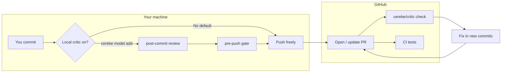

# Overview — how Cerebe Factory fits your workflow

**Cerebe Factory** is an AI **critic** on your changes: it reads the diff and your repo rules (`AGENTS.md`), then reports findings with severity, evidence, and requested fixes.

## Two places it runs

| Where | Who pays | Blocks you? |
|-------|----------|-------------|
| **GitHub pull request** — check name `cerebe/critic` | Cerebe Platform (org plan / trial for private repos) | Only if you **require** the check on `main` |
| **Your laptop** — after `cerebe model add …` | Your existing Cursor / Claude / Codex subscription | Blocks **`git push`** on `blocker` / `high` when local fleet is enabled |

**Not the same as unit-test CI.** GitHub Actions can run `npm test` and `cerebe doctor`. Hosted PR review is the **GitHub App**, not a workflow job that calls an LLM.

## Mental model (30 seconds)

## Golden rules

1. **Use pull requests** — hosted review runs on the PR, not on every direct push to `main`.
2. **Fix in new commits** — do **not** `git commit --amend` after Cerebe has reviewed a commit (verdict is tied to the SHA + diff).
3. **Maintain `AGENTS.md`** — agents and critics share this contract (commands, production facts, review etiquette).

## Severities (typical)

| Severity | Local pre-push (fleet on) | Hosted PR (Platform) |
|----------|---------------------------|----------------------|
| `blocker`, `high` | Can block push | Can block merge if check is required |
| Lower | Advisory | Advisory |

The hosted panel uses Cerebe’s critic fleet — not necessarily identical to your laptop fleet.
